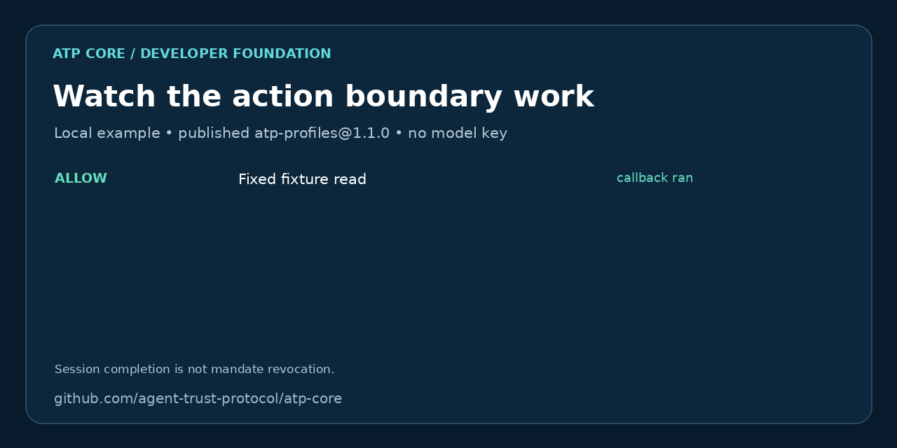

# Agent Trust Protocol™
### Check permission before your AI agent uses a tool

**Let a permitted tool action run. Block the next one when the policy says stop.** ATP Core gives developers policy-evaluation tools and examples of enforcing those decisions immediately before execution.

Start with a local demo, then connect the [Hermes tool hook](examples/hermes-hook/README.md). You can try both without a model API key. The examples have deliberately narrow permissions so you can inspect exactly what runs.

AI agents move between tools, organizations, and protocols. ATP is an open effort to make identity, trust evidence, and privacy controls portable across those boundaries. It complements MCP, A2A, ANP, ADK, and agent frameworks; it does not replace how agents communicate.

**Start building:** [SDK quickstart](#start-with-the-sdk) · [Scaffold an agent](#scaffold-a-project) · [Explore packages](#packages) · [Read specification drafts](https://w3c-cg.github.io/atp/specs/) · [Contribute](#help-shape-atp)

> ATP specifications are developed in the [W3C Agent Trust Protocol Community Group](https://www.w3.org/groups/cg/atp/). Community Group drafts are not endorsed by W3C and are not W3C Standards. Implementation support varies by capability; the repository and package READMEs describe what exists today.

## Try it in five minutes

No account, model API key, or hosted ATP service is needed. Use **Node.js 20 or 24** and npm for this walkthrough:

```bash
git clone https://github.com/agent-trust-protocol/atp-core.git
cd atp-core/examples/action-boundary
npm ci --ignore-scripts
npm start
```



Only the first callback runs. [Read the full walkthrough and text transcript](examples/action-boundary/README.md), or [try the Hermes hook walkthrough](examples/hermes-hook/README.md#reproduce-the-hook-decisions). This demo checks action category and session state; session completion is not mandate revocation.

## Protect one tool in Hermes

Already using Hermes Agent? [Start with the Hermes walkthrough](examples/hermes-hook/README.md): allow a read of one fixed file and block terminal, write and patch calls. The hook checks the action before Hermes dispatches the matched tool.

| Try | What you can verify |
| --- | --- |
| `npm run demo` in `examples/hermes-hook` | Four decisions through the real hook subprocess; Hermes is not started. |
| [Run the Hermes runtime verifier](examples/hermes-hook/README.md#verify-the-hermes-runtime) | A real Hermes tool read returns the fixture; a denied terminal call creates no sentinel file. Tool selection comes from a scripted local provider. |
| [Try it in your own Hermes profile](examples/hermes-hook/README.md#connect-a-live-hermes-profile) | Check consent and execution in your installed runtime, keeping its native permissions and sandbox. |

**Can you withdraw permission?** The local demo stops further reads when its session completes. That is not signed-mandate revocation. The Hermes example does not yet implement that revocation path; do not deploy it as a general agent authorization system.

We are looking for **five developers to try one protected tool** and tell us where setup breaks or the boundary falls short. [Join the developer pilot](docs/launch/developer-pilot.md). A failed setup is useful feedback too.

## What is here

| Area | Purpose | Current entry point |
| --- | --- | --- |
| Identity | `did:atp` identifiers and hybrid Ed25519/ML-DSA-65 key material | [DID package](packages/did-atp/README.md) |
| Trust | Evidence, credentials, scoring, and issuer/status work | [SDK](packages/sdk/README.md) and [drafts](https://w3c-cg.github.io/atp/specs/) |
| Policy | Reusable profile schema and action evaluation | [Profiles](packages/atp-profiles/README.md) |
| Interoperability | Conformance suites and work across agent systems | [Conformance runner](scripts/conformance.mjs) |

A passing test covers the behavior exercised by that test; it is not certification of every draft feature. Zero-knowledge range claims and some cross-protocol work remain experimental or in development.

## Packages

The package READMEs are the source for APIs, limitations, and examples. Install only what your application needs.

| Package | Use it for | Install |
| --- | --- | --- |
| [`atp-sdk`](packages/sdk/README.md) | Start an agent and use identity, credential, and trust utilities | `npm install atp-sdk` |
| [`create-atp-agent`](packages/create-atp-agent/README.md) | Scaffold a JavaScript ESM starter | `npx create-atp-agent my-agent` |
| [`@atpdeveloper/did-atp`](packages/did-atp/README.md) | Build and inspect canonical `did:atp` identifier primitives | `npm install @atpdeveloper/did-atp` |
| [`atp-profiles`](packages/atp-profiles/README.md) | Define and evaluate built-in security profiles | `npm install atp-profiles` |

OpenClaw remains a legacy optional adapter example, not a required ATP dependency. Use the SDK and canonical packages as the starting point for new integrations.

## See a protected action work

[Run the local action-boundary demo](examples/action-boundary/README.md): a permitted read runs, an approval-required callback stays blocked, and completing the session blocks further reads. It uses the published profile evaluator and needs no hosted ATP service or model API key.

[Try the Hermes Agent hook](examples/hermes-hook/README.md): connect the same published evaluator to Hermes' `pre_tool_call` boundary, allowing a fixed read while blocking terminal and write tools. The adapter documents its exact scope and Hermes consent setup.

## Start with the SDK

Use Node.js 20 or 24 for the SDK quickstart. Some published package metadata still advertises Node.js 18; the first-run probe in [security-readiness PR #170](https://github.com/agent-trust-protocol/atp-core/pull/170) records a Web Crypto failure there. Metadata correction awaits a versioned release.

```bash
npm install atp-sdk
```

```ts
import { Agent } from 'atp-sdk';

const agent = await Agent.quickstart('MyBot');
console.log(agent.getDID());
```

The standalone quickstart creates local identity material. A local identifier is not automatically publicly resolvable, and this snippet does not configure an issuer, external policy enforcement, or a production key store. See the [SDK guide](packages/sdk/README.md) before connecting real services.

## Scaffold a project

```bash
npx create-atp-agent my-agent
cd my-agent
npm start
```

The CLI creates a starter and offers a local configuration UI. That UI writes metadata; it does not mint a DID, register an issuer, or enforce the selected profile. The generated agent uses the SDK when it runs. See the [CLI guide](packages/create-atp-agent/README.md) for terminal-only and existing-project flows.

## Explore and test

```bash
git clone https://github.com/agent-trust-protocol/atp-core.git
cd atp-core
npm install
npm run conformance
```

The conformance runner exercises available implementation suites. For a package-specific change, follow that package's README and tests. Do not treat a passing run as a W3C certification or a claim that every draft capability is complete.

- [Specification drafts](https://w3c-cg.github.io/atp/specs/)
- [Community Group discussion](https://github.com/w3c-cg/atp)
- [Public developer website](https://agenttrustprotocol.com/)
- [Release/versioning policy](VERSIONING.md)

## Help shape ATP

You can participate without adopting the whole stack:

1. **Try one package** and file a reproducible issue with your Node version and a small example.
2. **Review a draft** and comment on identity, issuer authority, credential status, privacy, or conformance behavior in [the Community Group repository](https://github.com/w3c-cg/atp).
3. **Add an interoperability case** for an agent system you use, including expected behavior and a test vector where possible.
4. **Contribute code or docs** through a focused pull request. Start with [CONTRIBUTING.md](CONTRIBUTING.md).

**If ATP is useful to your agent project, [star this repository](https://github.com/agent-trust-protocol/atp-core) to follow its development.** Sharing a reproducible integration or reporting an onboarding problem also helps the project improve.

Issues and pull requests are welcome. Clearly distinguish implemented behavior from draft design and experimental work so other developers can make informed choices.

## Project boundaries

This repository is the open ATP Core implementation and developer tooling. The [website source](https://github.com/agent-trust-protocol/atp-website) is separate. [ATP Studio](https://studio.agenttrustprotocol.com/) is a separate enterprise product with its own infrastructure and data. Do not put Studio credentials, databases, or deployment configuration in ATP Core.

Agent Trust Protocol™ is a trademark of Sovr INC. See [LICENSE](LICENSE) for the repository license and the relevant package license metadata.
