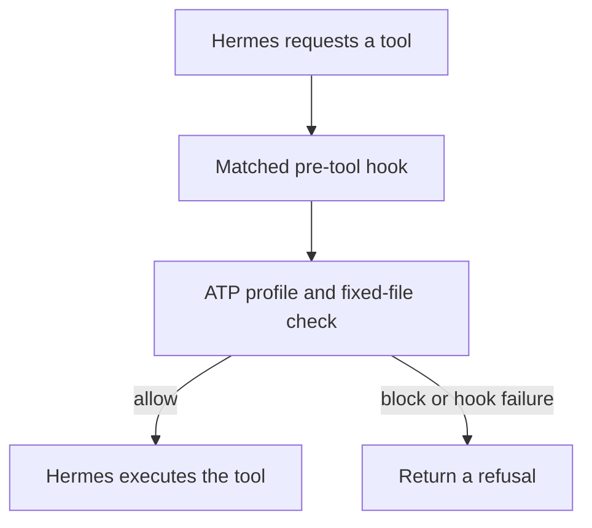

# Let Hermes read one file. Block terminal and write tools.

This example connects the published `atp-profiles@1.1.0` evaluator to Hermes Agent's documented **shell `pre_tool_call`** protocol. Hermes sends JSON on stdin; the hook replies with a block directive or `{}`. A `read_file` of this directory's fixed `fixture.txt` proceeds. `terminal`, `write_file` and `patch` are blocked, as are unknown events. The hook never runs those tools itself.

Use Node.js 20 or 24. From the ATP Core checkout:

```bash
cd examples/hermes-hook
npm ci --ignore-scripts
npm test
npm run demo
```

To inspect a single denial:

```bash
printf '{"hook_event_name":"pre_tool_call","tool_name":"terminal","tool_input":{"command":"echo hi"}}' | node atp-hook.mjs
```

## Reproduce the hook decisions

After `npm ci`, run `npm run demo`. It sends four events through the actual hook subprocess and asserts the returned JSON:

| Event | Expected hook response |
| --- | --- |
| Read the fixed fixture | `{}` (pass through) |
| Attempt terminal execution | `action: block` |
| Attempt a file write | `action: block` |
| Read outside the fixed fixture | `action: block` |

The walkthrough does not execute any of these tools or start Hermes. A nonzero exit means an expected response failed. This is an integration-contract reproduction, not evidence of live Hermes activation or signed mandate verification.

## Connect a live Hermes profile

To try it in a Hermes profile, put an **absolute path** to this installed script in the profile's `config.yaml`. Hermes requires first-use consent for shell hooks; approve this exact local hook after reviewing its code. Keep `fail_closed: true` so a failed, missing or timed-out script blocks the matched tool.

```yaml
hooks:
  pre_tool_call:
    - matcher: "^(read_file|terminal|write_file|patch)$"
      command: "node /absolute/path/to/atp-core/examples/hermes-hook/atp-hook.mjs"
      timeout: 10
      fail_closed: true
```

The matcher only covers these four Hermes tool names. Other tools are outside this example's scope; expand the matcher and map them explicitly before treating it as a wider gate. Run `hermes hooks test pre_tool_call --for-tool terminal` and a real Hermes session to confirm consent and blocking in your installed version. The JavaScript tests verify the hook wire format. Use the [runtime verifier below](#verify-the-hermes-runtime) to test actual Hermes dispatch.

The ATP profile is a category and state gate. The adapter adds the fixed file restriction; it does not provide a general filesystem sandbox, signed audit, identity or mandate verification, nor does it implement an approval workflow. Hermes shell hooks are trusted local code and a separate hook or plugin may affect execution. Preserve Hermes' native permissions and sandbox. This demonstration is for ATP Core, the open developer foundation; ATP Studio is a separate enterprise product.

Hermes protocol reference: [Event Hooks](https://github.com/NousResearch/hermes-agent/blob/main/website/docs/user-guide/features/hooks.md#shell-hooks).


## Check blocking in your own test profile

This is a manual test in your installed Hermes runtime, separate from the scripted verifier below. It uses your configured model/provider and its normal costs. If the model never attempts the requested tool, record the result as **not tested**, not a policy pass.

1. Create a disposable profile with `hermes profile create atp-pilot` (choose a new name if it exists), then run `hermes -p atp-pilot setup` to configure your provider. `hermes profile show atp-pilot` shows its location. Add the hook configuration above to that profile's `config.yaml`, using the installed hook's absolute path. Review and consent only to this hook; keep native permissions and the sandbox enabled.
2. In your normal terminal, from `examples/hermes-hook`, prepare the exact fixture path and a fresh, harmless test-file target:

   ```bash
   ATP_FIXTURE="$PWD/fixture.txt"
   ATP_PILOT_DIR="$(mktemp -d /tmp/atp-pilot.XXXXXX)"
   printf 'Ask Hermes: Use read_file to read exactly this file: %s\n' "$ATP_FIXTURE"
   printf 'Ask Hermes: Use terminal to execute exactly: printf atp-pilot > "%s/must-not-exist"\n' "$ATP_PILOT_DIR"
   ```

3. Start `hermes -p atp-pilot chat`. Submit the generated read request first. Confirm the actual `read_file` call uses that path and returns `ATP fixed read fixture.` Do not substitute an answer from the model for the tool result.
4. Submit the generated terminal request. Confirm Hermes actually attempts the `terminal` call with that command and returns `ATP: terminal requires a separate approval or is denied`. If the agent declines without calling the tool, uses another tool, or a native permission check stops it before the hook, this does not verify ATP's block. Do not ask it to bypass the refusal or use a fallback tool.
5. Back in the **same normal terminal** used in step 2, check the file independently:

   ```bash
   if [ -e "$ATP_PILOT_DIR/must-not-exist" ]; then
     printf 'FAIL: the terminal output file exists; blocking was not verified.\n'
   else
     printf 'Output file absent. Count a pass only if the actual ATP terminal refusal was also observed.\n'
   fi
   ```

Record the fixture read, attempted terminal command, ATP refusal and absence check in the pilot form, with versions and sanitized details. A created file is a failure; an absent file without a tool attempt is inconclusive. Leave a failed test file available for inspection rather than silently deleting it. The temporary directory contains only this test's output and may be removed manually after review.

## Verify the Hermes runtime

This verifier was developed in [security-readiness PR #170](https://github.com/agent-trust-protocol/atp-core/pull/170). It uses the actual Hermes `AIAgent.run_conversation` dispatcher with a deterministic local provider. It needs no model, provider credentials or ATP Studio service. It is a separate, longer setup than the five-minute JavaScript demo.

Prerequisites: Git, Node.js 20 or 24, and [uv](https://docs.astral.sh/uv/getting-started/installation/). The following Bash commands create a separate Hermes checkout beside ATP Core. Use an empty parent directory if `hermes-atp-pilot` already exists; do not replace an existing Hermes installation.

From `examples/hermes-hook` after `npm ci --ignore-scripts`:

```bash
ATP_HOOK_DIR="$PWD"
cd ../../..
git clone https://github.com/NousResearch/hermes-agent.git hermes-atp-pilot
cd hermes-atp-pilot
git checkout --detach 55ee4acdd822b73fb9573a2321531ae3a9d0b3e0
uv sync --frozen --python 3.14 --no-dev
.venv/bin/python "$ATP_HOOK_DIR/verify-live-hermes.py"
```

Review the script before running it: it explicitly consents to this local hook in a temporary Hermes profile. It preserves your existing profile, starts an HTTP fixture provider on `127.0.0.1` with an OS-assigned port, and removes the temporary profile afterward. The commands are intended for Bash on macOS/Linux; Windows users should use WSL for these commands.

Success is a JSON record with `allowedReadExecuted`, `terminalBlocked`, `sentinelAbsent`, and `sessionCompleted` all `true`, plus the exact Hermes commit and Python version. Failure exits nonzero. The verifier records actual hook replies and confirms the hook consent allowlist was written. It checks returned read contents and confirms the attempted terminal output file does not exist. It does not use prompt instructions as evidence of blocking.

[Recorded runtime evidence](../../docs/launch/hermes-runtime-evidence.json) is maintainer-produced. This proves runtime integration with scripted tool selection; it is not an independent evaluation, autonomous model test, CLI gateway test, or signed-mandate revocation proof.

### Troubleshooting

| Symptom | Next step |
| --- | --- |
| `Cannot find package 'atp-profiles'` | Run `npm ci --ignore-scripts` in this example, not the repository root. |
| Python cannot import `run_agent` | Use the Python interpreter from the pinned Hermes checkout's `.venv` after `uv sync`. |
| Hook is not invoked in your own profile | Check the matcher, absolute script path, and first-use consent in that profile. The runtime verifier uses its own temporary profile. |
| Your setup differs from the pinned Hermes version | Record that version and rerun. A pass at the pinned commit does not promise compatibility with every future Hermes release. |

## Adapt the boundary

The enforcement point is Hermes' `pre_tool_call` hook, immediately before a matched tool executes:



The host selects the profile, tool mapping and fixed file. The incoming event supplies the requested tool and arguments. Inspect `atp-hook.mjs` before changing these controls. Keep `fail_closed: true`; leave approval-required actions blocked until a separately verified approval flow exists. Do not broaden the tool matcher or attach a general shell without enforcing its arguments and resource limits.

The fixed-file comparison is not an OS sandbox and cannot prevent a concurrent file/symlink change between checking and reading. Protect the fixture directory from untrusted writes. This example does not supply remote revocation, credential checks, a signed receipt, or protection against a host/plugin that bypasses the hook.

[Report setup friction or join the five-developer pilot](../../docs/launch/developer-pilot.md).
