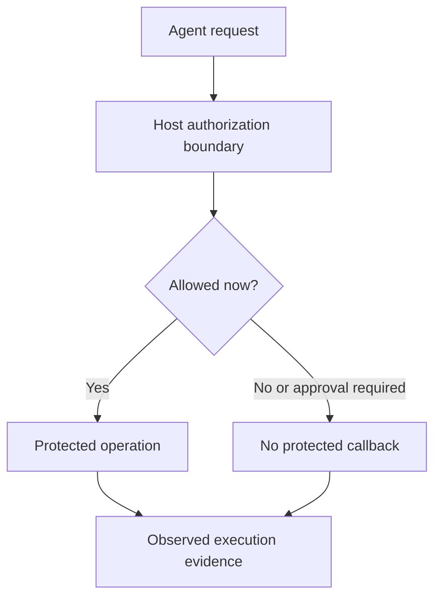

# ATP prevention and accountability assessment

Prepared November 12, 2026. Author-produced local demonstration; review draft.

## Result

**40 upstream tests passed, plus 22 assessor scenarios passed. Zero skips or failures.**
The five upstream suites and 22 scenarios overlap in coverage; these are not 62
independent security properties. Node v24.22.1 was used. See `results/assessment.json`
for the execution timestamp, source pin, file hashes, decisions, callback counts,
and exact upstream commands. The five TAP files contain the original test output.

Repository: https://github.com/agent-trust-protocol/atp-core

Commit: `f4ced09aaad2c10fc371fc8e7a0cde642984790f`.
Published evaluator consumed by the tool examples: `atp-profiles@3.0.0`.
The signed fixtures import SDK source at this commit, not the published SDK bundle.

## What this demonstrates

| Assessment | Tested implementation | Observed result | Boundary of claim |
|---|---|---|---|
| Prevent prohibited execution | Published profile evaluator + existing host boundary | Permitted fixed read executes; approval-required shell and completed-session read do not | Category/state gate, not general sandbox or signed-mandate revocation |
| Host tool integration | Existing Hermes hook in a real subprocess + assessor-owned dispatcher | Fixed read permitted; terminal, write, patch, outside path and unknown tool blocked | Hermes runtime itself not run |
| Action-bound authority | Existing synthetic live-read policy | Wrong action/resource, inactive operator, expired/future grant refused with zero callbacks | Identity, issuer and proof flags are trusted fixture inputs |
| Current authority | Same synthetic policy | Revoked, stale and unavailable status refused | Local injected status; no authenticated remote service or race guarantee |
| Human approval | Same synthetic policy | Missing/mismatched approval held; matching fixture approval permits | Approval verification is simulated; no durable consumption |
| Cryptographic integrity | Existing experimental signed-mandate suite using SDK crypto source | Tampering, wrong signature/key, unknown issuer and expiry refused | Ed25519 fixture encoding, not normative mandate wire format or PQ mandate verification |
| Signed request/replay | Existing two-key experimental fixture | Forged request refused; repeated signed request executes only once | In-memory nonce set; no crash/restart or multiworker guarantee |
| Accountability evidence | Assessment JSON and upstream TAP logs | Source/decision/execution evidence retained for reviewer inspection | Diagnostic files, not signed or append-only audit; no V19 integration or legal attribution |

The tool-boundary and signed-mandate/approval fixtures are **separate paths**.
This package does not imply that the Hermes hook incorporates the mandate fixture.
Future-grant refusal currently uses `mandate_expired` in the fixture; that is not
a demonstration of the proposed `evidence_not_yet_valid` reason or check order.

## How prevention and evidence fit together

The implementation being tested must make the decision before the protected
callback. An ALLOW positive control prevents a deny-everything system from
looking successful. Execution counts distinguish a real block from a system
that says DENY but still runs the callback.

Two comparison-oracle negative controls confirm that the assessor flags those
contradictions. They do not constitute mutation testing of the upstream source.
A third control calls a harmless unguarded counter directly: it remains callable.
This illustrates why all consequential paths need mediation and separate host
isolation. No malicious shell command is executed.

## Reproduce on your Mac

1. Install/use Node.js 24 and Git. Open Terminal in this extracted folder.
2. Run `bash setup.sh`. This creates a fresh `source/atp-core` checkout pinned to
   the commit above and installs three locked dependency sets with scripts disabled.
3. Run `node run.mjs source/atp-core`.
4. Read the terminal results and the files under `results/`.

Internet access is needed for initial Git/npm setup. The actual assessment runs
locally without model keys, Docker, external agent services, or paid accounts.
`setup.sh` refuses an existing destination; rerun the node command on the already
prepared checkout instead. `run.mjs /absolute/path/to/atp-core` also works after
preparing a matching checkout and its dependencies.

The runner verifies its pinned upstream source files against Git before running.
Its provenance manifest is diagnostic, not an independently signed attestation.

## Shared test proposals for Paola, Yanfeng and Adolfo

| Proposed collaboration | Inputs needed | Acceptance evidence | Current status |
|---|---|---|---|
| Independent replication | Reviewer executes this package | Reviewer-owned transcript with same pin and declared environment | Not yet performed |
| V19 evidence bridge | Versioned V19 schema and implementation, approval binding and log verifier | Same action ID across request, decision, execution and recorded outcome; tamper/rollback/crash cases | Not tested |
| ARIA identity bridge | Pinned ARIA credential verifier, explicit issuer trust/key discovery and status policy | Valid credential does not grant excess authority; wrong issuer/key/status refuses execution | Not tested |
| Real runtime mediation | Installed Hermes or another runtime and tool adapter | Permitted fixture read succeeds; denied real tool leaves no side-effect marker; alternate routes tested | Not run here |
| Production revocation | Authenticated status service, defined freshness and execution consistency | Revocation, outage, cached evidence and race outcomes agree with declared semantics | Not tested |
| Durable replay/approval consumption | Transactional multiworker execution store | Retry, restart and concurrency cannot consume authority twice | Not tested |
| Durable evidence | Signed/checkpointed log with independent verification | Detect edit/delete/reorder/truncation relative to trusted checkpoints and survive application rollback | Not tested |

These are proposed contributions for review, not requirements adopted by another
group. No external email, issue, commit, PR, deployment or publication was made.
Community Group drafts are not W3C Standards or W3C endorsement.

## Appropriate public statement

“At the pinned ATP Core commit, we reproduced 40 existing tests and 22 local
assessment scenarios with no failures or skips. Tool-boundary examples block
callbacks before execution; separate experimental fixtures exercise authority
constraints, signed requests and replay rejection. Authenticated distributed
revocation, production approval handling, durable audit and cross-project
interoperability remain separate validation gates. We invite independent reruns.”
